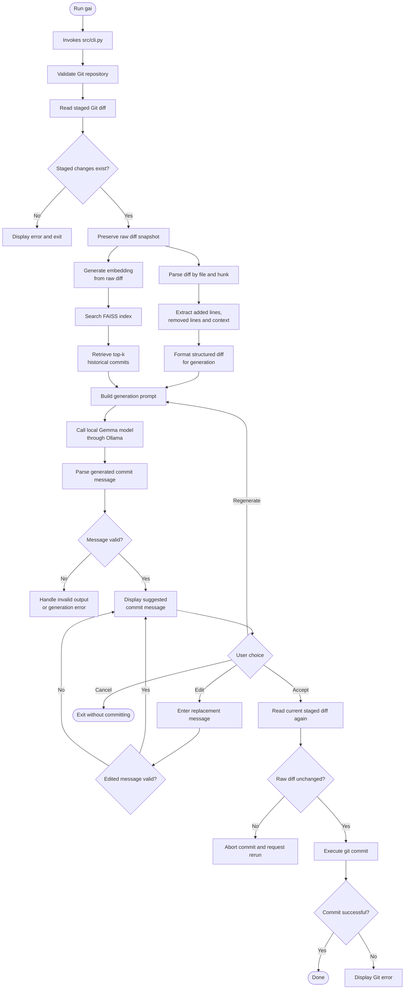

# GAI — LLM-Powered Git Commit Message Generator

GAI generates Git commit messages locally using Ollama, FAISS, and historical commit data from your repository. It retrieves similar past commits, analyzes the staged changes, and generates a message that follows your existing tagging conventions.

The goal is to make commit messages more specific to the actual code changes, even when working with large diffs, without relying on external LLM APIs.

## How It Works

GAI follows a retrieval-augmented generation (RAG) pipeline:

1. **Read staged changes:** Extract the Git diff for the files staged for commit.
2. **Parse the diff:** Separate changes by file and hunk, identifying added lines, removed lines, and unchanged context.
3. **Retrieve similar commits:** Embed the raw diff using EmbeddingGemma and search the FAISS index for relevant historical examples.
4. **Generate a message:** Pass the formatted diff and retrieved examples to the local Gemma model.
5. **Review and commit:** Accept, edit, regenerate, or cancel the suggested message. GAI commits only after explicit confirmation.

The raw diff is retained for retrieval and integrity checks, while the formatted representation helps the generation model focus on the actual changes.


## FAISS Index Preparation

GAI uses historical commits as examples of both code changes and commit message style.

The dataset in `data/commit_messages.json` contains commit tags, messages, and diffs. The indexing pipeline embeds usable historical diffs with `embeddinggemma:latest` and stores the vectors in a FAISS `IndexFlatL2` index.

The generated files are:

- `vectorstore/commits.index` — FAISS vector index.
- `vectorstore/metadata.json` — corresponding commit metadata.

To build or rebuild the index, run this from the project root:

```bash
python -m src.index
```

Rebuild the index when the dataset changes or when the embedding model or diff representation changes. The stored vectors and metadata must remain aligned.

## Setup

### Prerequisites

- Python
- [uv](https://docs.astral.sh/uv/)
- Git
- [Ollama](https://ollama.com/)

### 1. Clone the repository

```bash
git clone <repository-url>
cd <repository-directory>
```

### 2. Create and activate the environment

```bash
uv venv
source .venv/Scripts/activate
```

The activation command above is for Windows Git Bash. On Linux or macOS, use `source .venv/bin/activate`.

### 3. Install dependencies

```bash
uv pip install -r requirements.txt
```

### 4. Download the models

```bash
ollama pull embeddinggemma:latest
ollama pull gemma4:e2b
```

Use the generation model configured in `src/generate.py`. If you have changed it to another model, pull that model instead.

#### Change the context window of gemma model to 16K
- Follow any tutorial, create a Modelfile and setup some system prompts for your variant llm
```bash
ollama create gemma4-64k -f Modelfile
```

### 5. Build the index

Ensure `data/commit_messages.json` is available, then run:

```bash
python -m src.index
```

## Using GAI

Stage the changes you want to commit:

```bash
git add src/generate.py src/retrieve.py
```

Run GAI:

```bash
python -m src.cli
```

To control the number of historical examples retrieved:

```bash
python -m src.cli --top-k 3
```

GAI presents a suggested commit message and waits for your choice:

- `Y` — accept and commit.
- `e` — edit the message.
- `r` — regenerate.
- `n` — cancel without committing.

GAI does not stage files automatically. Before committing, it checks that the staged diff has not changed since the message was generated.

## Bash Command

For convenience, the repository includes a `gai` Bash wrapper. Configure its project path and ensure it invokes the Python CLI using the project's virtual environment.

For Windows Git Bash, make the wrapper executable:

```bash
chmod +x gai
```

Place it in a directory on your `PATH`, such as `~/bin`, and add that directory to your `PATH` if necessary.

You can then run the command from your target Git repository:

```bash
git add .
gai
```

The wrapper should preserve the current working directory so Git operates on the repository where the command was invoked.

## Future Prospects

- **Parallel LangGraph workflow:** Run retrieval-based generation alongside an independent diff-understanding chain.
- **Hierarchical diff summarization:** Summarize large diffs by file and hunk before generating a second candidate.
- **Evaluator and reducer:** Evaluate both candidates for factual accuracy, relevance, specificity, and tag validity, then select or synthesize the final message.
- **Improved retrieval:** Experiment with change-focused embeddings and per-file or per-hunk retrieval.
- **Evaluation pipeline:** Compare generated messages against held-out historical commits using tag accuracy, relevance, correctness, and latency.
- **Fine-tuning:** Explore fine-tuning only if retrieval and prompt improvements are insufficient.

The immediate priority is to improve the quality of diff parsing and generation while preserving the existing retrieval pipeline. The parallel workflow and evaluator/reducer remain planned improvements.


### How to pipe git-diff to clipboard
```bash
git diff HEAD | tee git_diff.txt | clip
```
